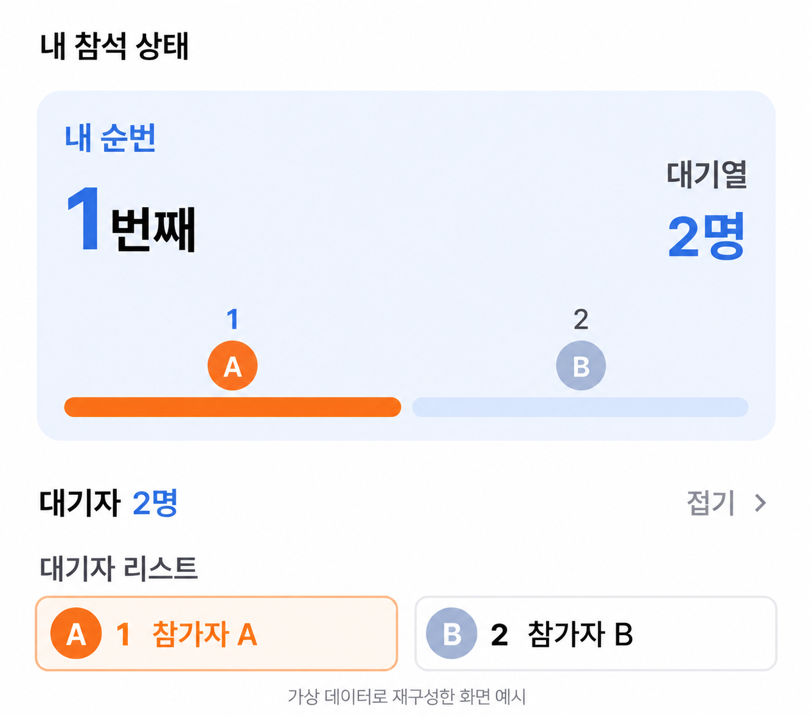
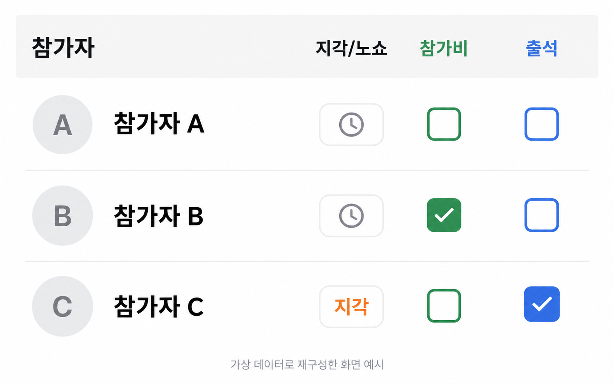

# 모미 Momi

취미 모임을 찾고, 일정을 함께하고, 모임 운영을 이어가는 앱입니다.

참가자에게는 참석과 대기 상태를 이해하기 쉽게, 운영자에게는 출석과 멤버 현황을 한곳에서 확인하기 쉽게 만드는 데 집중합니다.

[공식 홈페이지](https://momiapp.net/) · [사용 가이드](https://momiapp.net/guide) · [UI 설계 노트](docs/design-notes.md)

## 주요 기능

| 흐름 | 할 수 있는 일 |
| --- | --- |
| 모임 발견 | 지역과 취미에 맞는 모임을 찾아 소개와 일정을 확인 |
| 참석과 대기 | 일정에 참여하고, 자리가 없을 때 대기 순번과 좌석 제안을 확인 |
| 모임 운영 | 출석·지각·노쇼·참가비 납부 상태와 멤버 활동을 관리 |
| 대화와 커뮤니티 | 모임에서 대화하고 취미 이야기와 사진을 공유 |

기능과 이용 권한은 운영 플랜 및 역할에 따라 달라집니다. 현재 서비스 안내는 [공식 홈페이지](https://momiapp.net/)를 참고해 주세요.

## 화면으로 보는 사용자 흐름

아래 이미지는 가상 참가자 데이터를 사용해 AI로 재구성한 설명용 이미지입니다. 실제 앱 캡처가 아니며, 배포된 앱의 화면과 차이가 있을 수 있습니다.

### 내 대기 순번 확인

자리가 없는 일정에서 내 순번과 전체 대기 인원을 함께 보여줍니다. 내 위치를 먼저 읽고, 아래에서 대기 목록을 확인할 수 있도록 구성합니다.

### 출석과 참가비 확인

참가자 한 명의 상태를 같은 행에서 비교합니다. 출석과 참가비는 별도 항목으로 나누고, 지각 여부는 글자로도 표시합니다.

### 게임 현황 요약 디자인

게임 순서와 참가자만 남겨 한 줄에 두 게임을 표시하는 디자인 콘셉트입니다. 종료된 게임과 진행 중인 게임을 구분하되, 색상 외에도 제목으로 상태를 읽을 수 있도록 구성했습니다.

이 이미지는 UI 탐색 과정의 콘셉트이며, 해당 배치가 현재 앱에 반영되었다는 의미는 아닙니다.

## Android 개발 구성

| 기술 | 역할 |
| --- | --- |
| Kotlin · Jetpack Compose | 화면 구성과 상태에 따른 UI 표현 |
| ViewModel · UseCase · Repository | 화면 상태, 동작, 데이터 접근의 책임 분리 |
| Room | 로컬 데이터 저장과 캐시 |
| Coil | 화면 크기와 용도에 맞는 이미지 로딩 |
| Firebase | 인증과 서버 데이터 연동 |

[UI 설계 노트](docs/design-notes.md)에서는 정보 밀도, 상태 구분, 화면 표시 정책을 설명합니다.

## 저장소 구성

- `assets/`: 가상 데이터로 재구성한 설명 이미지와 디자인 콘셉트
- `docs/design-notes.md`: UI 설계 의도와 개발 접근
- 이 저장소는 제품과 개발 과정을 소개하는 자료입니다. 실행 가능한 앱 소스나 운영 환경 설정은 포함하지 않습니다.
