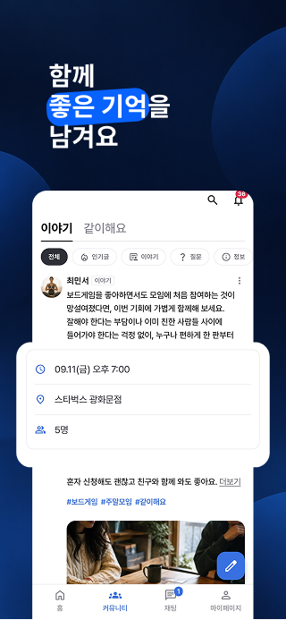
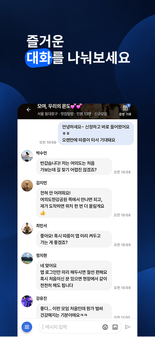
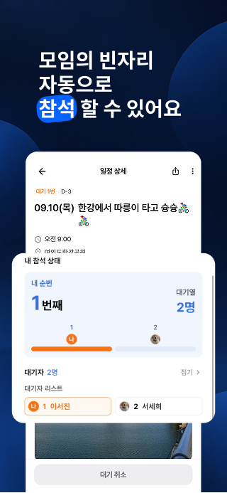
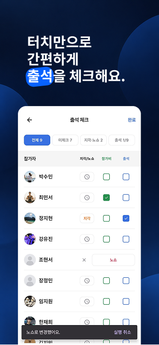

# 모미 Momi

취미 모임을 찾고, 일정을 함께하고, 모임 운영을 이어가는 앱입니다.

취미가 통하는 사람을 만나고, 함께할 일정을 고르고, 대화와 기록을 이어갑니다. 참석 대기와 출석 확인 등 모임 운영에 필요한 기능도 함께 제공합니다.

[공식 홈페이지](https://momiapp.net/) · [사용 가이드](https://momiapp.net/guide) · [배드민턴 자동 매칭](https://momiapp.net/badminton/)

## 모미를 소개합니다

| 취미가 통하는 사람들과 | 나에게 맞는 모임 발견 | 함께 남기는 이야기 |
| :---: | :---: | :---: |
|  |  |  |

| 즐거운 모임 대화 | 빈자리 참석 대기 | 터치로 간편한 출석 확인 |
| :---: | :---: | :---: |
|  |  |  |

모미 앱 소개용으로 제작한 원본 이미지입니다. 화면 구성과 기능은 앱 버전에 따라 달라질 수 있습니다. [앱 화면 크게 보기](docs/gallery.md)

## 주요 기능

| 흐름 | 할 수 있는 일 |
| --- | --- |
| 모임 발견 | 지역과 취미에 맞는 모임을 찾아 소개와 일정을 확인 |
| 참석과 대기 | 일정에 참여하고, 자리가 없을 때 대기 순번과 좌석 제안을 확인 |
| 모임 운영 | 출석·지각·노쇼·참가비 납부 상태와 멤버 활동을 관리 |
| 대화와 커뮤니티 | 모임에서 대화하고 취미 이야기와 사진을 공유 |

기능과 이용 권한은 운영 플랜 및 역할에 따라 달라집니다. 현재 서비스 안내는 [공식 홈페이지](https://momiapp.net/)를 참고해 주세요.

## 배드민턴 자동 매칭

배드민턴 모임에서 매번 다음 경기를 짜는 일을 줄여 주는 웹 도구입니다. 참가자를 입력하면 실력과 참여 횟수를 고려해 복식 대진표를 자동으로 편성합니다.

**[배드민턴 자동 매칭 사용하기 →](https://momiapp.net/badminton/)**

| 진행 흐름 | 할 수 있는 일 |
| --- | --- |
| 참가자 준비 | 이름을 등록하고 실력 그룹과 파트너 조건을 설정 |
| 다음 게임 편성 | 적게 뛴 참가자를 먼저 고려하고, 실력과 조합을 반영해 복식 경기 구성 |
| 현장 상황 반영 | 참가자 추가, 휴식, 선수 교체 등 현장 변화에 맞춰 조정 |
| 게임 진행 관리 | 예정·진행 중·완료 상태를 확인하며 게임 시작과 완료 처리 |

참가 인원과 설정에 따라 편성 결과가 달라집니다. 자동으로 만든 대진을 확인하고 현장에 맞게 조정할 수 있습니다.

## Android 개발 구성

| 기술 | 역할 |
| --- | --- |
| Kotlin · Jetpack Compose | 화면 구성과 상태에 따른 UI 표현 |
| ViewModel · UseCase · Repository | 화면 상태, 동작, 데이터 접근의 책임 분리 |
| Room | 로컬 데이터 저장과 캐시 |
| Coil | 화면 크기와 용도에 맞는 이미지 로딩 |
| Firebase | 인증과 서버 데이터 연동 |

[UI 설계 노트](docs/design-notes.md)에서는 정보 밀도, 상태 구분, 화면 표시 정책을 설명합니다.

## 저장소 구성

- `assets/promo/`: 모미 앱 소개용 원본 포스터 6장
- `assets/screenshots/`: 앱 화면 캡처 4장
- `docs/gallery.md`: 앱 화면 상세 갤러리
- `docs/design-notes.md`: UI 설계 의도와 개발 접근
- 이미지의 구분은 [이미지 안내](assets/README.md)에 정리했습니다.
- 이 저장소는 제품과 개발 과정을 소개하는 자료입니다. 실행 가능한 앱 소스나 운영 환경 설정은 포함하지 않습니다.
