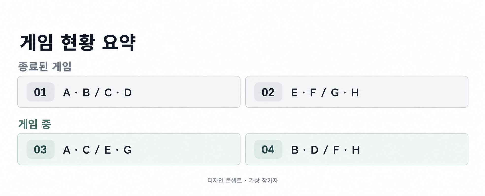

# 배드민턴 게임 현황의 정보와 버튼 정리

[모미 소개](../../README.md) · [매칭 설계](badminton-matching.md) · [참석 확정 처리](offer-confirmation.md)

여러 경기를 운영할 때는 다음 참가자와 게임 순서를 빠르게 읽어야 합니다. 모미 배드민턴 화면의 디자인 탐색에서는 반복되는 상태 문구와 강한 버튼 색을 줄이고, 게임 정보와 조작 영역의 관계를 다시 정리했습니다.

## 처음 화면에서 발견한 문제

출발점은 카드마다 네 명의 참가자, 게임 순서, 상태, 시작 또는 완료 버튼을 함께 보여주는 목록이었습니다. 중앙에 놓인 채도 높은 버튼은 참가자 이름과 시선을 경쟁했고, 상태와 행동이 같은 라벨에 들어가 한 번에 읽을 내용이 많았습니다.

완료된 경기도 같은 카드 밀도를 유지하면 다음 경기를 찾기 위해 더 긴 목록을 훑게 됩니다. 그래서 현재 조작이 필요한 경기와 기록만 확인하면 되는 경기를 다르게 보여주는 방향을 비교했습니다.

## 비교한 배치

| 방향 | 얻으려는 효과 | 확인할 점 |
| --- | --- | --- |
| 카드 안 오른쪽에 버튼 배치 | 참가자 정보를 먼저 읽고 오른쪽에서 동작 선택 | 좁은 화면에서 이름 공간과 버튼의 터치 영역 확보 |
| 경기 카드와 조작 카드를 분리 | 선수 정보와 시작·완료 동작의 시각적 구분 | 버튼이 어느 경기의 것인지 간격과 정렬로 연결 |
| 종료·진행 중 경기를 상단 요약 | 게임 번호와 이름만으로 최근 현황 확인 | 현재 경기의 상세 조작 영역과 구분 |

오른쪽 배치를 비교할 때는 점 세 개 메뉴를 없애고 자주 쓰는 동작을 직접 드러냈습니다. 카드 분리안에서는 시각적으로 나누더라도 경기와 버튼의 연결이 끊겨 보이지 않는지가 핵심입니다.

## 색상과 정보량을 줄이는 과정

| 항목 | 출발점 | 탐색한 방향 |
| --- | --- | --- |
| 주요 버튼 | 카드 중앙의 강한 파랑 | 오른쪽 정렬과 작은 강조 면적 |
| 게임 상태 | 상태와 행동을 한 라벨로 반복 | 예정·게임 중·종료를 짧은 상태 표현으로 구분 |
| 색상 | 여러 강조색이 동시에 등장 | 중립색을 바탕으로 진행 상태만 제한적으로 강조 |
| 완료 기록 | 참가자 카드와 조작을 함께 유지 | 게임 순서 번호와 참가자 이름만 남겨 요약 |

게임 중과 예정은 서로 구별하되 색상만으로 전달하지 않습니다. 요약에서는 섹션 제목이 상태를 맡고 각 행에서는 번호와 이름을 읽게 했습니다.

## 상단 게임 요약 콘셉트

위 이미지는 가상 참가자를 사용한 디자인 콘셉트입니다. 종료된 경기와 진행 중인 경기를 각각 묶고, 한 줄에 두 경기씩 표시하는 방향을 보여줍니다. 이 배치의 서비스 반영이나 사용성 개선 효과를 뜻하지 않습니다.

## 다음 확인 기준

두 열 배치는 넓은 화면에서 비교하기 쉽지만 긴 이름이나 글자 확대에는 불리할 수 있습니다. 모바일 구현에서는 폭이 부족하면 한 열로 전환하고, 이름을 줄여도 게임 번호와 팀 구분을 유지하는 기준이 필요합니다.

다음 비교에서는 같은 가상 대진을 두 배치로 보여주고 현재 경기 찾기, 다음 참가자 확인, 해당 경기 시작하기를 수행해 볼 수 있습니다. 시각적인 간결함과 실제 조작의 정확도를 함께 확인하는 단계입니다.

[기존 UI 설계 노트](../design-notes.md) · [배드민턴 사용하기](https://momiapp.net/badminton/)
