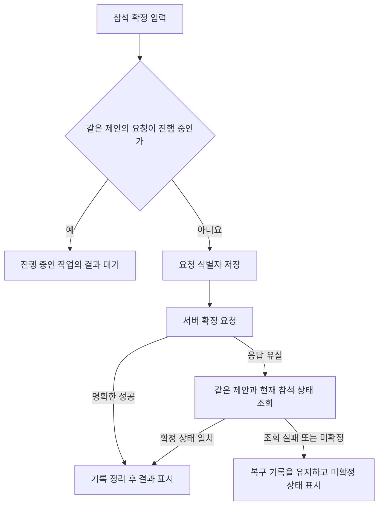

# 참석 확정 요청의 중복과 응답 유실 처리

[모미 소개](../../README.md) · [UI 개선 과정](game-ui-iteration.md) · [매칭 설계](badminton-matching.md)

참석 확정 버튼을 여러 번 누르거나 요청 직후 통신이 끊기면 같은 작업을 다시 보내기 쉽습니다. 모미 Android의 대기 자리 확정 처리에서는 진행 중인 요청을 공유하고, 결과가 불분명할 때는 같은 자리 제안의 상태를 확인하는 방식으로 이 문제를 다룹니다.

## 버튼 비활성화 이후의 문제

버튼을 누르는 동안 비활성화하면 한 화면의 연속 입력은 줄일 수 있습니다. 하지만 다른 진입점의 요청이나 화면 재생성까지 같은 작업으로 묶어 주지는 않습니다. 특히 서버가 처리한 뒤 응답만 유실된 경우에는 오류를 받았다는 사실만으로 실패라고 판단할 수 없습니다.

그래서 화면의 로딩 표시와 별도로 저장소 계층에서 같은 제안에 대한 요청을 묶습니다. 실제 요청 식별에는 사용자, 모임, 일정, 자리 제안의 식별자를 사용합니다.

## 한 요청을 여러 화면에서 기다리기

같은 제안을 확정하는 작업이 진행 중이면 새 작업을 만들지 않고 기존 작업의 결과를 기다립니다. 코루틴의 공유 작업과 잠금을 사용해 확인과 등록이 겹치지 않게 합니다.

클라이언트의 요청 공유는 같은 저장소 인스턴스에서 진행 중인 작업의 범위입니다. 여러 기기에서 들어오는 요청까지 다루려면 서버에서도 제안 상태와 참석 변경을 원자적으로 검증해야 합니다.

## 보내기 전에 복구 기록 남기기

원격 요청 전에 정확한 제안의 식별자를 로컬 저장소에 기록합니다. 저장을 마치지 못하면 서버 요청을 보내지 않습니다. 그래야 요청 직후 앱이 종료돼도 어떤 작업의 결과를 확인해야 하는지 남습니다.

Android 구현은 디스크 기록 완료 여부를 확인하는 저장소를 사용합니다. 재진입 시 복구는 확정 요청을 다시 보내는 대신 기록된 제안의 상태를 조회합니다.

## 응답 유실을 성공이나 실패로 단정하지 않기

| 확인한 상황 | 처리 방향 |
| --- | --- |
| 정확한 제안이 확정이고 현재 참석 정보도 일치 | 복구 완료 후 기록 정리 |
| 제안이 아직 대기 중이거나 조회에 실패 | 복구 기록 유지 |
| 이전 제안이 만료 또는 취소 | 해당 제안 기록만 정리 |
| 권한 거절처럼 명확한 실패 | 자동 재전송 없이 실패 전달 |
| 로그아웃 또는 계정 전환 | 이전 세션의 늦은 응답을 현재 화면에 반영하지 않음 |

현재 참석 상태가 확정이라는 이유만으로 이전 제안까지 성공했다고 보지 않습니다. 취소 후 다시 신청해 다른 제안을 받은 경우가 있기 때문입니다. 제안 식별자와 사용자, 일정의 일치 여부를 함께 확인합니다.

같은 사용자로 다시 로그인해도 이전 요청이 새 세션의 결과가 되지 않도록 세션 세대도 확인합니다. 이 원칙은 사용자 식별자 비교만으로 잡기 어려운 늦은 응답을 다루는 데 도움이 됩니다.

## 공개 코드와 검증

[공개 예제](../../examples/offer-confirmation.mjs)는 흐름을 읽기 쉽게 JavaScript로 재작성했습니다. 요청 공유, 저장 후 전송, 응답 유실 조회, 계정 세대 확인을 담고 있으며 원격 통신과 저장소는 주입합니다. 실제 Android 구현은 코루틴과 디스크 저장소를 사용합니다.

[테스트](../../examples/offer-confirmation.test.mjs)는 다음 상황을 검증합니다.

- 동시에 10번 확정해도 원격 쓰기는 한 번만 실행
- 응답 유실 후 제안과 참석 상태를 확인하고 추가 쓰기 없이 복구
- 저장소를 유지한 채 처리 객체를 다시 만들면 조회만으로 복구
- 다른 제안, 참석 정보 불일치, 조회 실패를 성공으로 오인하지 않음
- 만료·취소 시 해당 기록만 정리하고 저장 실패 시 전송하지 않음
- 명확한 거절은 재시도하지 않고 같은 사용자 재로그인도 이전 결과 차단

예제 테스트는 인메모리 저장소를 공유해 처리 객체 재생성을 재현합니다. 실제 프로세스 종료 후 디스크 보존이나 기기 네트워크 동작을 검증하는 테스트는 아닙니다. 원격 콜백의 시간 제한과 서버 검증도 예제 외부의 책임입니다.

2026년 10월 30일 Node.js 24.16.0에서 공개 참석 확정 예제 테스트 10개가 통과했습니다. [예제 실행 안내](../../examples/README.md)에서 같은 검증을 실행할 수 있습니다.
